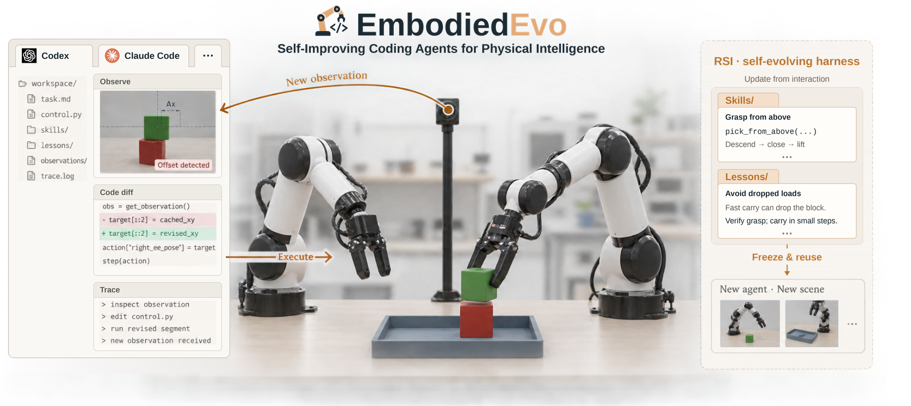

# EmbodiedEvo: Self-improving Code Agents for Physical Intelligence

<!-- Release links: wrap each badge in an <a> when its page is available.
     arXiv: https://arxiv.org/abs/ARXIV_ID
     Project page: https://lab.einsia.ai/embodiedevo/
     Update the provisional BibTeX entry below after the arXiv release. -->
<p align="center">
  
  <a href="https://lab.einsia.ai/embodiedevo/">
    
  </a>
</p>

<p align="center">
  
</p>

**Building visual and physical intelligence through code.**

EmbodiedEvo runs a coding agent in a persistent RoboDojo simulation session. During
Playground, the agent observes the scene, executes Python, and writes reusable
Skills and Lessons. Test freezes that knowledge and starts a fresh agent,
workspace and simulator for each new scene.

## Setup

Use a Linux host and Python 3.11 or newer for the orchestration environment:

```bash
python3 -m venv .venv
.venv/bin/python -m pip install -r requirements-host.txt -e '.[dev]'
.venv/bin/python -m unittest discover -s tests -v
```

Build the thin coding-agent image directly from the included Dockerfile:

```bash
docker build -t embodiedevo-agent:latest docker/agent
```

The Dockerfile installs pinned Codex CLI 0.159.2 and basic Python/image tools;
no host Codex installation or API key is needed for the build. Its context
contains no credentials, task files or simulator assets. Build
the image on each Docker host that will run agents; the simulator is provisioned
separately. See [the complete image build procedure](docs/INSTALL.md#thin-agent-container).

Run commands from this repository root. The editable installation keeps task
templates and recipes available at their source paths. The project is currently
distributed as a source checkout, not a standalone wheel with simulator assets.

Real episodes require a separately provisioned RoboDojo/Isaac Sim environment,
assets, an available NVIDIA GPU, Docker, and configured model credentials.
Follow [installation](docs/INSTALL.md), including
[Codex API configuration](docs/CODEX_API.md), before starting an experiment.

## Playground and Test

After setup, choose a native task with `--env-task`. The model and reasoning
effort are explicit in `tasks/RoboDojo/task.toml`; configure them before a new run.

```bash
RUN_DIR="runs/$(date +%Y%m%d%H%M)_stack_bowls"
.venv/bin/embodiedevo explore --task RoboDojo --env-task stack_bowls \
  --run-dir "$RUN_DIR" --gpu 0
.venv/bin/embodiedevo test --task RoboDojo --env-task stack_bowls \
  --run-dir "$RUN_DIR" --gpu 0
```

`embodiedevo run` performs both stages. Test-only baseline:

```bash
.venv/bin/embodiedevo test --task tasks_baseline/RoboDojo --env-task stack_bowls \
  --run-dir "runs/$(date +%Y%m%d%H%M)_stack_bowls_baseline" --gpu 0
```

The baseline starts with its own instruction and no transferred Skills/Lessons.
Public task recipes are enabled by default for both configurations, matching the
source snapshot. Set `EMBODIEDEVO_USE_RECIPE=0` before preparing a new run to omit
that supplied knowledge. The choice and recipe source are recorded per run.
See [the protocol](docs/PROTOCOL.md) and [running and evaluation](docs/RUNNING.md).

## Source map

| Path | Role |
| --- | --- |
| `orchestrator/` | Task configuration, isolated agents, sessions, freeze and Test lifecycle |
| `environments/`, `simulators/` | Python execution, four primitives and RoboDojo adaptation |
| `integrations/robodojo_policy/` | XPolicyLab policy and native evaluation transport |
| `tasks/RoboDojo/` | Playground/Test templates, primitive manual and public recipes |
| `tasks_baseline/RoboDojo/` | Fresh Test-only baseline |
| `docker/agent/`, `scripts/` | Thin agent image, provisioning and diagnostics |
| `tests/` | CPU tests; optional transport tests require a provisioned XPolicyLab |

Cluster campaigns, private deployment profiles, historical recovery tools,
dashboards and result archives are outside this source distribution.
[Source provenance](docs/SOURCE.md) describes the export and its validation limits.

## License and third-party material

A project-wide license has not yet been selected. This is a local release
preparation, not yet a licensed public release. The included RoboProbe task
recipes retain their Apache-2.0 license and source attribution; see
[third-party notices](THIRD_PARTY_NOTICES.md).

## Citation

If you use EmbodiedEvo in your research, please cite the manuscript below.
This provisional citation will be updated with the arXiv identifier after release.

```bibtex
@misc{li2026embodiedevo,
  title  = {{EmbodiedEvo}: Self-improving Code Agents for Physical Intelligence},
  author = {Li, Wenyi and Chi, Yizhe and Zheng, Youjie and Liu, Chunyu and
            Wang, Xiaoqiu and Gao, Mingju and Jiang, Zheng and Hong, Deyao and
            Xiao, Calvin and Yang, Kaisen and Na, Qinhuai},
  year   = {2026}
}
```
